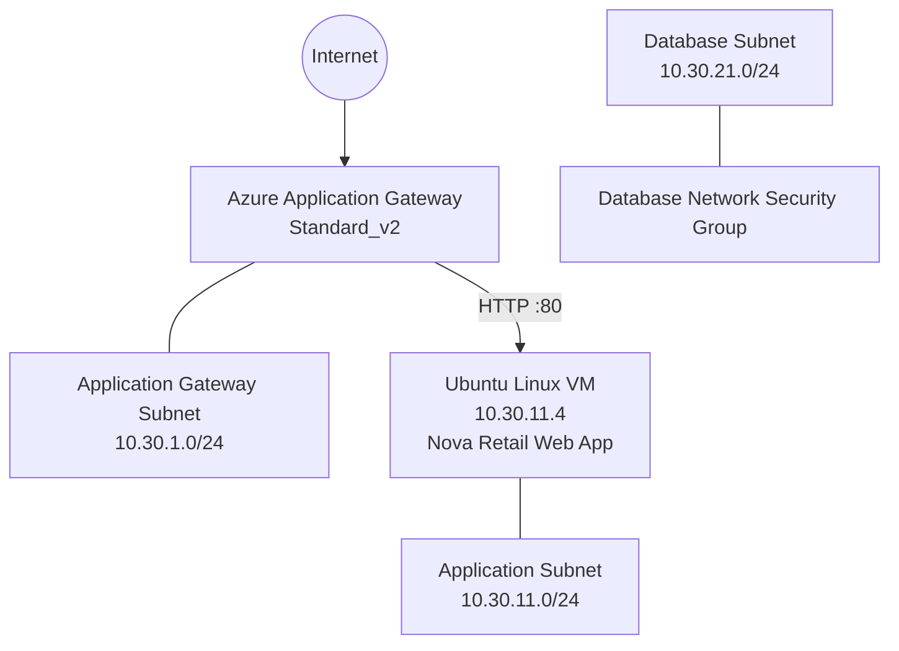
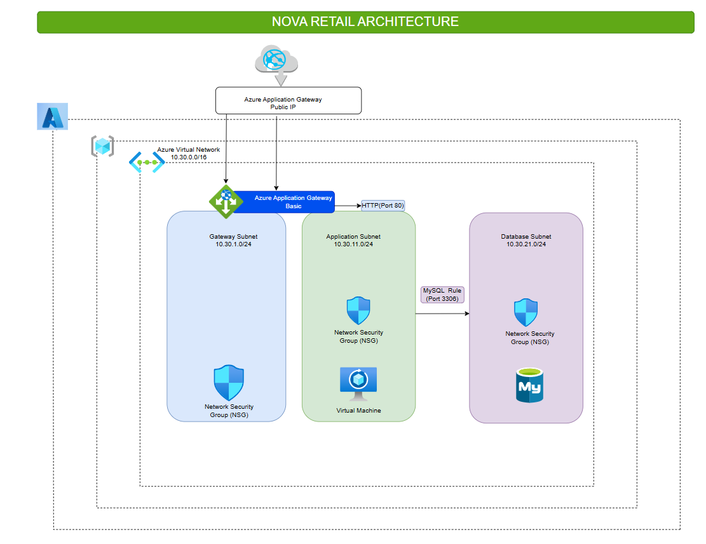

# nova-retail-azure


# Nova Retail – Azure Infrastructure Automation

**A cloud infrastructure automation project demonstrating Microsoft Azure, Terraform, Linux, networking, and application delivery.**

## Project Overview

Nova Retail is a demonstration retail application deployed on Microsoft Azure using Terraform.

The project demonstrates how cloud infrastructure can be provisioned and managed as code, with a focus on network segmentation, secure infrastructure design, application delivery, and infrastructure automation.

The application is hosted on an Ubuntu Linux virtual machine in Azure. External HTTP traffic is routed through Azure Application Gateway to the application server on a private subnet.

**Cloud provider:** Microsoft Azure  
**Infrastructure as Code:** Terraform  
**Region:** South Africa North  
**Operating System:** Ubuntu Server 24.04 LTS  
**Application delivery:** Azure Application Gateway Standard_v2  
**Version control:** Git and GitHub

## Architecture

### Architecture overview



### Network design

The Azure Virtual Network uses the address space `10.30.0.0/16` and is divided into three subnets:

| Subnet | Address range | Purpose |
|---|---|---|
| Application Gateway | 10.30.1.0/24 | Application Gateway |
| Application | 10.30.11.0/24 | Application virtual machine |
| Database | 10.30.21.0/24 | Reserved database network |

Network Security Groups control traffic between application and database network segments.

The application subnet permits HTTP traffic from the Application Gateway subnet. A database security rule is configured to permit MySQL traffic on port 3306 from the application subnet.


### Azure Deployment Architecture



The architecture illustrates the Azure Virtual Network, segmented subnets, Application Gateway, Linux application VM, and reserved database tier.

The infrastructure is deployed in South Africa North using Terraform.
## Azure Infrastructure Components

| Component | Purpose |
|---|---|
| Resource Group | Organises project resources |
| Virtual Network | Provides isolated network infrastructure |
| Subnets | Separates gateway, application and database workloads |
| Network Security Groups | Controls network traffic |
| Linux Virtual Machine | Hosts the Nova Retail application |
| Network Interface | Connects the VM to the virtual network |
| Public IP | Provides temporary VM connectivity for testing |
| Application Gateway | Provides public HTTP entry and routes requests to the application |
| Terraform | Provisions and manages infrastructure |

## Application

The Nova Retail demonstration application is hosted on an Ubuntu Linux virtual machine.

The application is served using Python's built-in HTTP server, managed as a Linux systemd service.

The demonstration product catalogue includes:

- Wireless Headphones – R899.00
- Smart Watch – R1,499.00
- Bluetooth Speaker – R649.00

The application is accessed through the public frontend of Azure Application Gateway.

## Technology Stack

- Microsoft Azure
- Terraform
- Azure Resource Manager
- Azure CLI
- Ubuntu Server 24.04 LTS
- Python
- Linux systemd
- Git and GitHub
- Mermaid architecture diagrams

## Infrastructure Deployment

The infrastructure is managed through Terraform.

### Prerequisites

- An Azure subscription
- Azure CLI
- Terraform CLI
- Git
- An authenticated Azure CLI session

### Authentication

```powershell
az login
az account set --subscription "<SUBSCRIPTION_ID>"
```

Set the subscription environment variable for Terraform:

```powershell
$env:ARM_SUBSCRIPTION_ID = az account show --query id --output tsv
```

### Initialise Terraform

```powershell
terraform init
```

### Format and validate configuration

```powershell
terraform fmt -recursive
terraform validate
```

### Review the deployment plan

```powershell
terraform plan
```

### Deploy infrastructure

```powershell
terraform apply
```

Review the Terraform plan carefully before approving any deployment.

## Deployment Validation

The deployment was tested to confirm that the infrastructure and application were operational.

Validation included:

- Successful Terraform provisioning.
- Azure virtual machine provisioning and running status.
- Linux application service running successfully.
- HTTP response verification from the application server.
- Application Gateway backend health reporting **Healthy**.
- Successful HTTP 200 response from the backend.
- Successful access to the Nova Retail application through the Application Gateway public IP.

## Security Considerations

The project demonstrates several infrastructure security practices:

- Network segmentation using dedicated subnets.
- Network Security Groups to restrict inbound traffic.
- Application traffic routed through Azure Application Gateway.
- SSH key-based authentication configured for the Linux virtual machine.
- Database subnet separated from the application subnet.
- Infrastructure managed through version-controlled Terraform configuration.

**Note:** This is a development demonstration, not a production-ready retail platform. The temporary VM public IP and HTTP-only application access are intended for testing. Production deployment would require additional hardening, HTTPS, managed secrets, monitoring, and a fully implemented database layer.

## Cost Management

This project was deployed as a temporary demonstration environment.

Azure resources can incur charges while provisioned, including Application Gateway and virtual machine resources.

The project should be destroyed after testing to avoid unnecessary ongoing costs.

## Infrastructure Cleanup

Terraform is used to remove the provisioned infrastructure.

Review the resources before destruction:

```powershell
terraform plan -destroy
```

Destroy the resources when testing and evidence collection are complete:

```powershell
terraform destroy
```

Confirm that the deployment is no longer required before approving destruction.

## Project Structure

```text
nova-retail-azure/
│
├── main.tf
├── network.tf
├── vm.tf
├── application-gateway.tf
├── .gitignore
├── .terraform.lock.hcl
└── README.md
```

## Key Learning Outcomes

This project demonstrates practical experience in:

- Azure infrastructure provisioning using Terraform.
- Infrastructure as Code and resource lifecycle management.
- Azure virtual networking and subnet design.
- Network Security Group configuration.
- Linux virtual machine administration.
- Application Gateway configuration and backend health validation.
- Azure CLI authentication and resource management.
- Git-based infrastructure version control.
- Cloud cost awareness and resource cleanup.

---

**Project:** Nova Retail – Azure Infrastructure Automation  
**Repository:** [nova-retail-azure](https://github.com/corettakingsley/nova-retail-azure)
